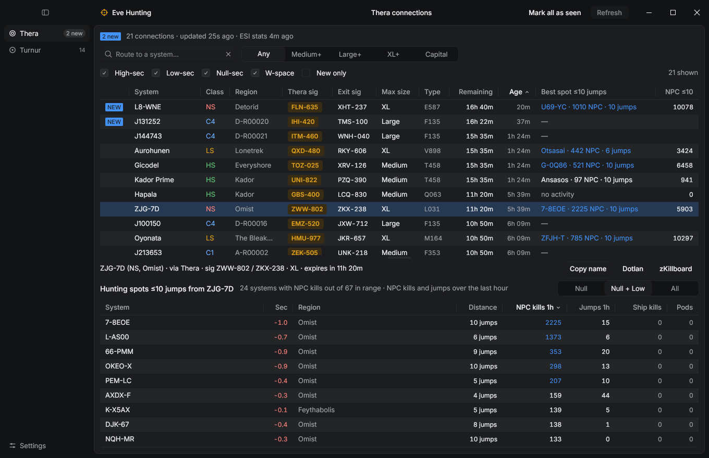
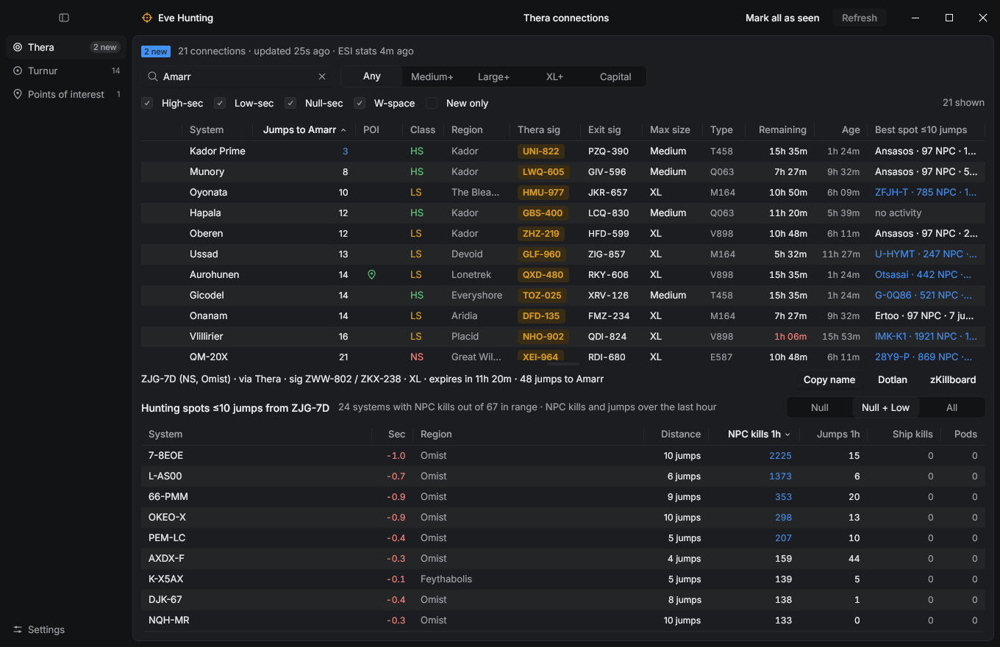
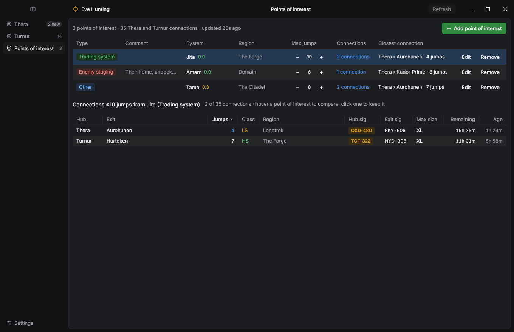
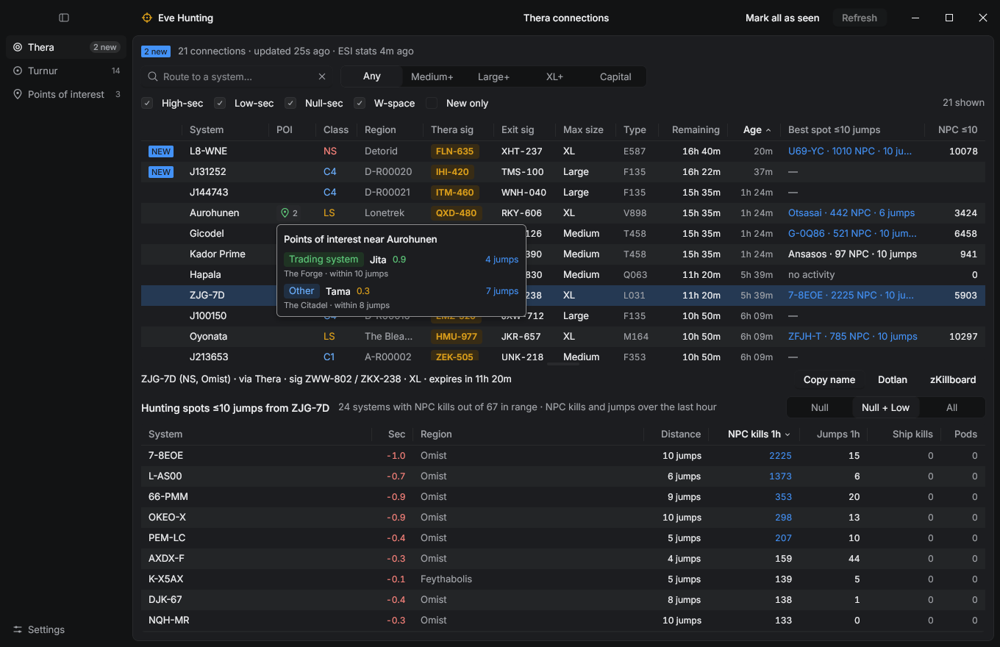
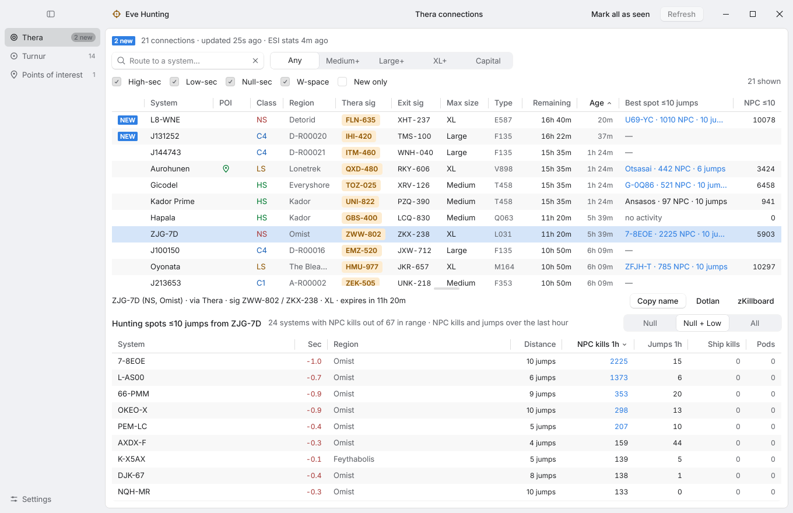
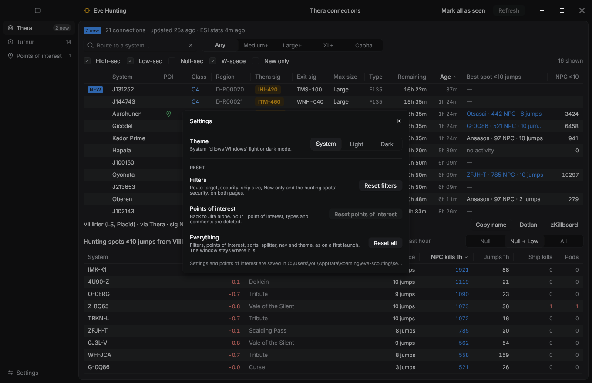

# Eve Hunting

A native desktop companion for EVE Online hunters, written in Rust with the
[Rune](https://github.com/anomalyco/rune) UI framework.

It tracks the **Thera** and **Turnur** wormhole connections published by
[EVE-Scout](https://www.eve-scout.com/) in real time, and for every k-space exit lists the
systems within **10 jumps** that had the most NPC kills in the last hour, so you can see
where the ratters are before you jump.



## Features

- **One page per hub** (Thera, Turnur) in a left nav, each keeping its own selection and sort.
- **Live connections**: refreshed every minute from EVE-Scout. New ones are marked `NEW` for
  30 minutes, counted in the nav and in the window title.
- **Hunting spots**: for the selected exit, every system within 10 stargate jumps with NPC
  kills in the last hour, with its distance, jumps, ship and pod kills. Choose Null, Null + Low
  or All. The connections table shows each exit's best spot and the NPC kills in range, both
  sortable.
- **Route to a system**: type three letters of any k-space system and pick it from the list
  (arrows and Enter work too). Both pages gain a *Jumps to …* column, the gate jumps from each
  exit to that system, and sort by it, closest first. Clear the field to drop it.
- **Points of interest**: a third page lists the systems you watch (an enemy staging, a trade
  hub, anything else), each with an optional type and comment, and a number of jumps. Jita is there to start
  with. Each shows how many Thera and Turnur exits are within its jumps and the closest one;
  hover one to list those connections, click it to keep them listed. The green **+ Add point of interest**
  button at the page's top right opens a dialog (the same three-letter search, type, comment, jumps); each row
  has **Edit** and **Remove**, and − and + change its jumps directly.
  On the Thera and Turnur pages, a **POI** column shows a pin on every exit within range of a
  point of interest (red for an enemy staging, green for trading, blue for other, with how many
  when several); click it for each one's type, jumps and comment. A click elsewhere, Esc or the
  card's ✕ closes it.
- **Routes**: click any number of jumps (the route column, the spots' distance, the points of
  interest's jumps and their card) for the gate route behind it: each system with its
  security, and the region where it changes. A click elsewhere or Esc closes it.
- **Filters**: high/low/null/W-space, minimum ship size, new connections only.
- **Quick links** for any connection or spot: copy the name (double-click a row), open the
  Dotlan region map on the system with the NPC layer, or zKillboard (Anoik.is for wormholes).
- **Desktop niceties**: integrated titlebar, resizable splitter between the two tables, light,
  dark or system theme, and the window, page, filters, route target, points of interest, sorts
  and layout restored on the next launch.











## Data sources

| Data | Source | Refresh |
|---|---|---|
| Thera and Turnur connections | EVE-Scout public API, `api.eve-scout.com/v2/public/signatures` | every 60 s, or **Refresh** |
| NPC, ship and pod kills, jumps (last hour) | CCP's ESI, `universe/system_kills` and `universe/system_jumps` (the numbers Dotlan shows) | every 10 min; ESI regenerates them hourly |
| Stargate map (k-space systems and gates) | CCP's static data via [Fuzzwork](https://www.fuzzwork.co.uk/dump/), built into the binary as `data/universe.tsv` | when you regenerate it |

No account or API key is needed; everything used is public.

## Build and run

Rune is pre-release and pinned to a revision of its `dev` branch in `Cargo.toml`. The Rust
toolchain is pinned in `rust-toolchain.toml` (1.99.1) and installed by `rustup` on first build.

```sh
cargo run --release
```

The first build compiles Rune and its GPU stack, so allow some minutes and a few GB of disk in
`target/`.

The app is developed on Windows. Rune also runs on macOS and Linux, where the titlebar follows
each platform's conventions.

### Settings

Settings and points of interest are saved as JSON to `%APPDATA%\eve-scouting\settings.json` on
Windows (`$XDG_CONFIG_HOME/eve-scouting/` or `~/.config/eve-scouting/` elsewhere), as soon as
they change. The settings dialog resets one part at a time:

- **Reset filters**: the route target, security, ship size, New only and the spots' security.
- **Reset points of interest**: back to Jita alone (asks to confirm).
- **Reset all**: everything as on a first launch except the window's place (asks to confirm).

## Development

```sh
cargo test
```

Every page can be rendered headless from the frozen data in `fixtures/`, without network and
with default settings:

```sh
cargo run -- --snap shots/thera-dark.png --scene demo --theme dark --size 1360x880 --scale 1
```

Scenes: `demo`, `demo-turnur`, `demo-tall` (splitter dragged), `demo-null` (null-sec spots),
`demo-settings` (dialog open), `demo-light` (light theme forced), `demo-route` (routing to
Amarr), `demo-search` (system suggestions open), `demo-poi` (points of interest), `demo-poi-hint` (a POI pin's card), `demo-settings-confirm` (a reset to confirm),
`demo-poi-add` and `demo-poi-edit` (its dialog).

To regenerate the stargate map after CCP adds systems:

```sh
python scripts/update_universe.py
```

The app icon is drawn in `assets/icon.svg`. After editing it, regenerate the `.ico` that
`build.rs` embeds in the exe (building on Windows needs the Windows SDK's `rc.exe`):

```sh
cargo run --example make_icon
```

### Layout

| Path | What |
|---|---|
| `src/main.rs` | Window setup, settings loading, titlebar |
| `src/hubs.rs` | The hub pages: state, refresh thread, filters, route search, hunting spots, view |
| `src/hubs/poi.rs` | The points of interest page |
| `src/api.rs` | EVE-Scout client |
| `src/universe.rs` | Stargate map (system search, routes), ESI hourly stats, hunting spot search |
| `src/settings.rs` | Settings saved between runs |
| `data/universe.tsv` | K-space systems and gates, generated by `scripts/update_universe.py` |
| `fixtures/` | Saved API responses for tests and headless scenes |
| `assets/` | The app icon (`icon.svg`, the `icon.ico` made from it) and its Windows resource file |
| `build.rs` | Embeds the icon in the Windows executable |

## Credits

Wormhole connections by [EVE-Scout](https://www.eve-scout.com/). Activity data from CCP's
[ESI](https://developers.eveonline.com/). Map data from CCP's static data export, mirrored by
Fuzzwork.

EVE Online and all related names are trademarks of CCP hf. This project is not affiliated
with or endorsed by CCP.
