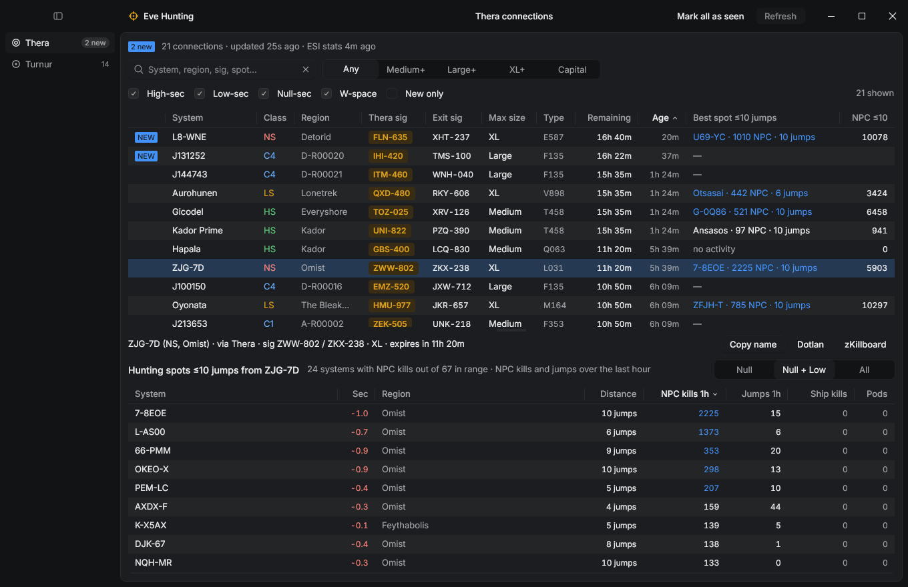
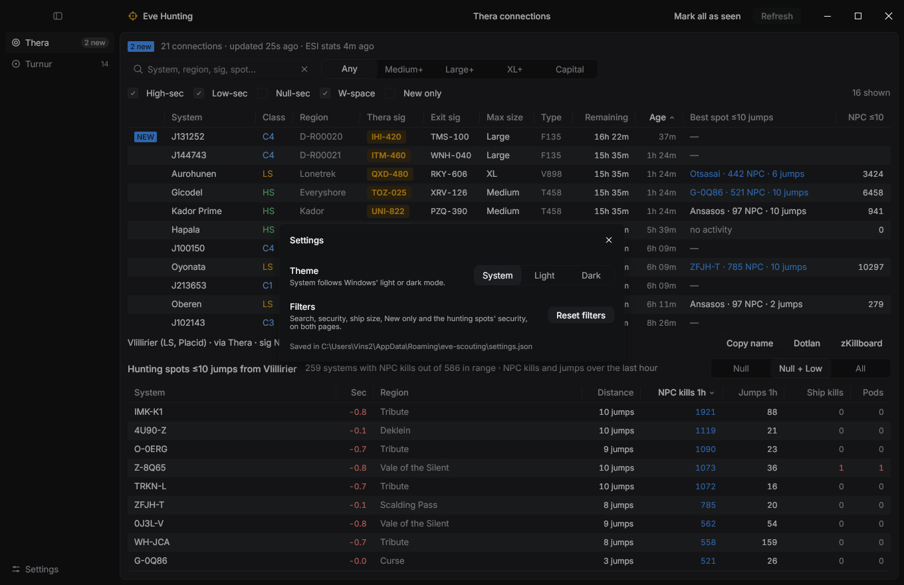

# Eve Hunting

A native desktop companion for EVE Online hunters, written in Rust with the
[Rune](https://github.com/anomalyco/rune) UI framework.

It tracks the **Thera** and **Turnur** wormhole connections published by
[EVE-Scout](https://www.eve-scout.com/) in real time, and for every k-space exit lists the
systems within **10 jumps** that had the most NPC kills in the last hour, so you can see
where the ratters are before you jump.



## Features

- **One page per hub** (Thera, Turnur) in a left nav, each keeping its own selection and sort.
- **Live connections**: refreshed every minute from EVE-Scout. New ones are marked `NEW` for
  30 minutes, counted in the nav and in the window title.
- **Hunting spots**: for the selected exit, every system within 10 stargate jumps with NPC
  kills in the last hour, with its distance, jumps, ship and pod kills. Choose Null, Null + Low
  or All. The connections table shows each exit's best spot and the NPC kills in range, both
  sortable.
- **Filters**: search (system, region, signature, or a spot's name), high/low/null/W-space,
  minimum ship size, new connections only.
- **Quick links** for any connection or spot: copy the name (double-click a row), open the
  Dotlan region map on the system with the NPC layer, or zKillboard (Anoik.is for wormholes).
- **Desktop niceties**: integrated titlebar, resizable splitter between the two tables, light,
  dark or system theme, and the window, page, filters, sorts and layout restored on the next
  launch.



## Data sources

| Data | Source | Refresh |
|---|---|---|
| Thera and Turnur connections | EVE-Scout public API, `api.eve-scout.com/v2/public/signatures` | every 60 s, or **Refresh** |
| NPC, ship and pod kills, jumps (last hour) | CCP's ESI, `universe/system_kills` and `universe/system_jumps` (the numbers Dotlan shows) | every 10 min; ESI regenerates them hourly |
| Stargate map (k-space systems and gates) | CCP's static data via [Fuzzwork](https://www.fuzzwork.co.uk/dump/), built into the binary as `data/universe.tsv` | when you regenerate it |

No account or API key is needed; everything used is public.

## Build and run

Rune is pre-release and pinned to a revision of its `dev` branch in `Cargo.toml`. The Rust
toolchain is pinned in `rust-toolchain.toml` (1.99.1) and installed by `rustup` on first build.

```sh
cargo run --release
```

The first build compiles Rune and its GPU stack, so allow some minutes and a few GB of disk in
`target/`.

The app is developed on Windows. Rune also runs on macOS and Linux, where the titlebar follows
each platform's conventions.

### Settings

Settings are saved as JSON to `%APPDATA%\eve-scouting\settings.json` on Windows
(`$XDG_CONFIG_HOME/eve-scouting/` or `~/.config/eve-scouting/` elsewhere). Delete the file to
start over; **Settings → Reset filters** resets the filters only.

## Development

```sh
cargo test
```

Every page can be rendered headless from the frozen data in `fixtures/`, without network and
with default settings:

```sh
cargo run -- --snap shots/thera-dark.png --scene demo --theme dark --size 1360x880 --scale 1
```

Scenes: `demo`, `demo-turnur`, `demo-tall` (splitter dragged), `demo-null` (null-sec spots),
`demo-settings` (dialog open), `demo-light` (light theme forced).

To regenerate the stargate map after CCP adds systems:

```sh
python scripts/update_universe.py
```

### Layout

| Path | What |
|---|---|
| `src/main.rs` | Window setup, settings loading, titlebar |
| `src/hubs.rs` | The hub pages: state, refresh thread, filters, hunting spots, view |
| `src/api.rs` | EVE-Scout client |
| `src/universe.rs` | Stargate map, ESI hourly stats, hunting spot search |
| `src/settings.rs` | Settings saved between runs |
| `data/universe.tsv` | K-space systems and gates, generated by `scripts/update_universe.py` |
| `fixtures/` | Saved API responses for tests and headless scenes |

## Credits

Wormhole connections by [EVE-Scout](https://www.eve-scout.com/). Activity data from CCP's
[ESI](https://developers.eveonline.com/). Map data from CCP's static data export, mirrored by
Fuzzwork.

EVE Online and all related names are trademarks of CCP hf. This project is not affiliated
with or endorsed by CCP.
